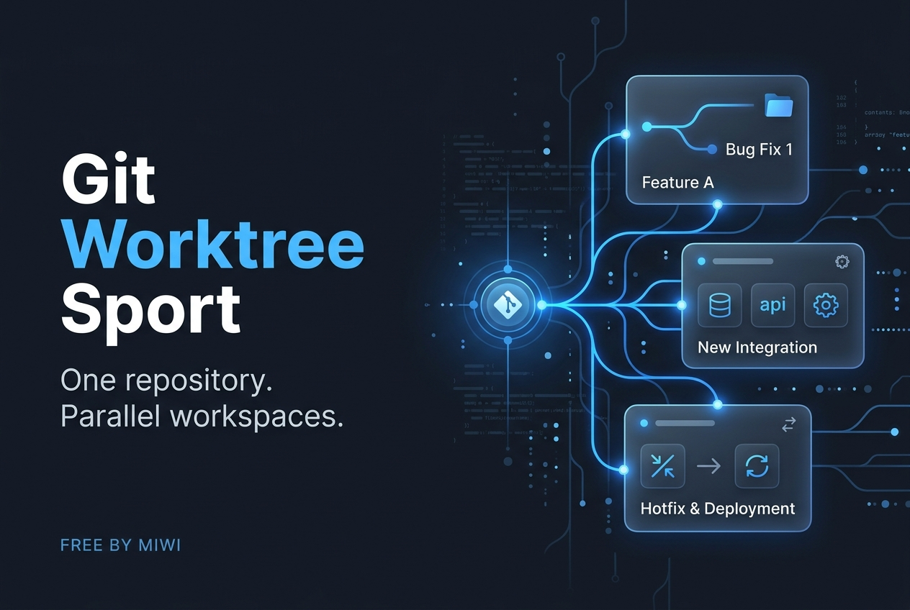
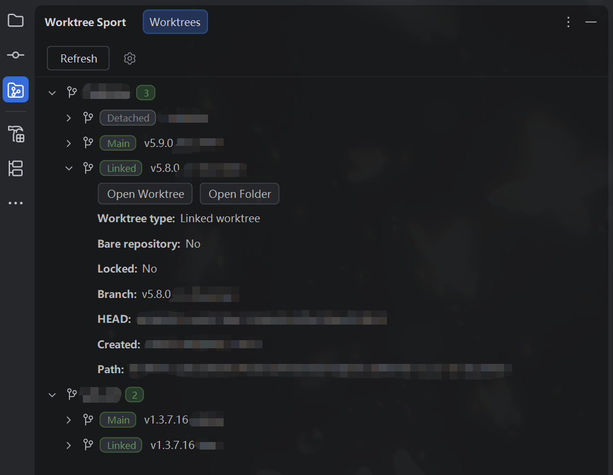
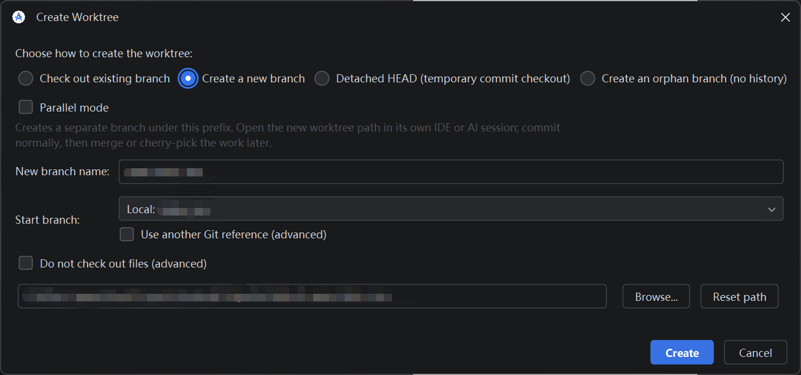
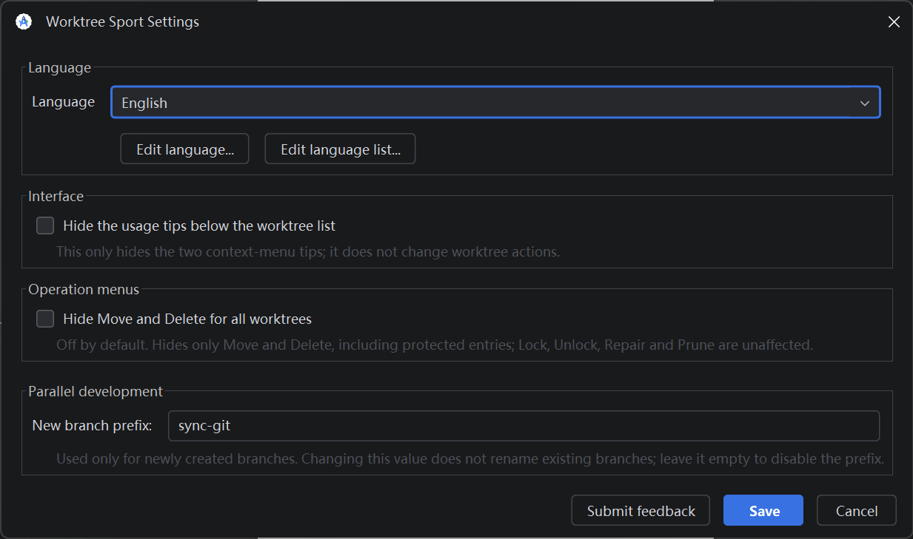
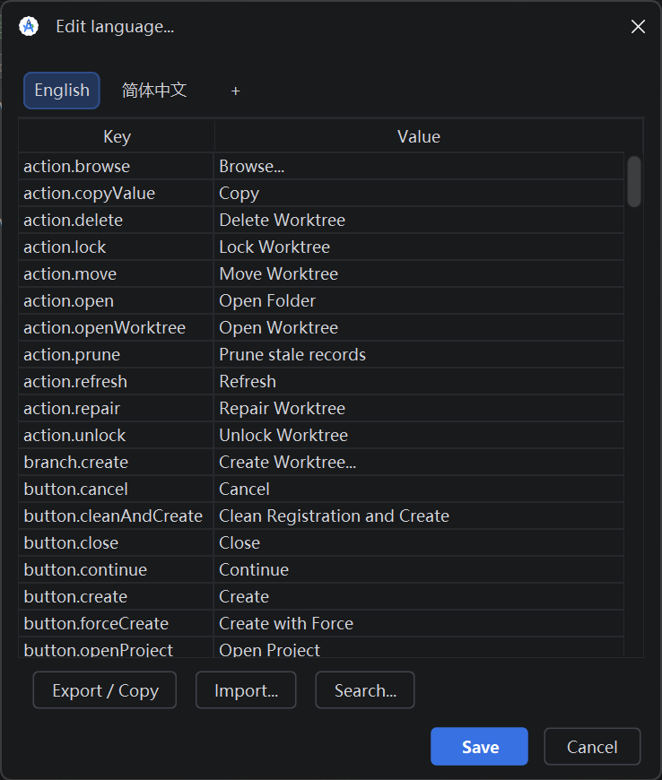

# Git Worktree Sport

Git Worktree Sport is a free IntelliJ Platform plugin for creating and managing Git worktrees from the IDE. It is built and verified against Android Studio Panda 3 and uses the Git executable configured in the IDE.

> One repository. Parallel workspaces.

## What it provides

- A tree of worktrees collected from repositories in projects open in the IDE.
- Compact status badges, branch, full HEAD, path and folder creation time.
- Safe create, open, lock, unlock, repair, prune, move and delete operations.
- Conflict handling for stale registrations, active branches, missing folders and dirty directories.
- Progress dialogs that block repeated operations until Git finishes.
- Open Worktree and Open Folder actions, plus copy-value actions for detail rows.
- Main/current-project protection for high-risk operations.
- A table-based translation editor with independent language catalog, import/export validation and Ctrl+F search.
- Ten bundled languages: English, Simplified Chinese, Traditional Chinese, Japanese, Korean, German, French, Spanish, Portuguese (Brazil), and Russian.

## Overview



Git Worktree Sport keeps parallel tasks in separate working directories while they share one Git repository. Use **Git → Worktree Sport → Refresh** to open the manager, then right-click empty space to browse branches and create a worktree. You can also use **Create Worktree...** from the IDE Git Branches popup.

### Worktree manager



Expand a worktree to inspect its status, branch, full HEAD, path and creation time. Double-click expands or collapses. Right-click a detail row copies only that value.

### Create a worktree



Creation modes are mutually exclusive: use an existing branch, create a new branch, use detached HEAD, or create an orphan branch. **Do not check out files** is an optional advanced setting and is off by default.

### Language tools



Translations are stored separately from the language-name catalog. Keys are read-only, values are editable, and imports validate missing, duplicate and unknown keys before saving.



The default Overview for JetBrains Marketplace is English. The plugin UI follows the IDE language or a configured language pack.

## Requirements

- Android Studio Panda 3 or a compatible IntelliJ Platform build at or above `262.9437.185`.
- Git plugin enabled in the IDE.
- A configured local Git executable.
- Current delivery was compiled and tested on Windows with JDK 25. Other IDE products, builds and operating systems need separate verification.

## Build and install locally

```powershell
$env:JAVA_HOME = "C:\Program Files\Android\Android Studio Panda 3\jbr"
.\gradlew.bat clean buildPlugin --no-daemon --console=plain
```

The plugin ZIP is generated under `build/distributions/`. To install it, use **Settings → Plugins → Install Plugin from Disk...** and select the generated ZIP.

## Documentation

- [English Marketplace description](docs/overview/description.html)
- [Illustrated Overview guide](docs/overview/index.html)
- [Overview asset notes](docs/overview/README.md)
- [Chinese usage notes](使用说明.md)

## License

This project is licensed under the [Apache License 2.0](LICENSE).
